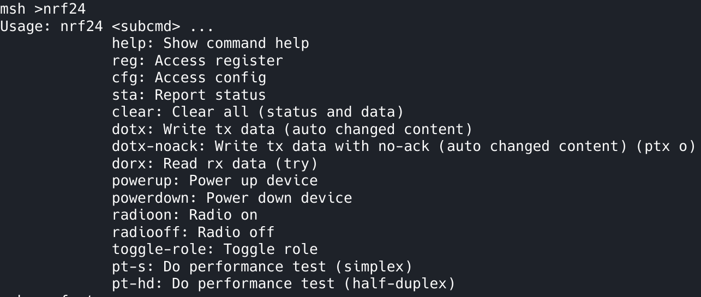
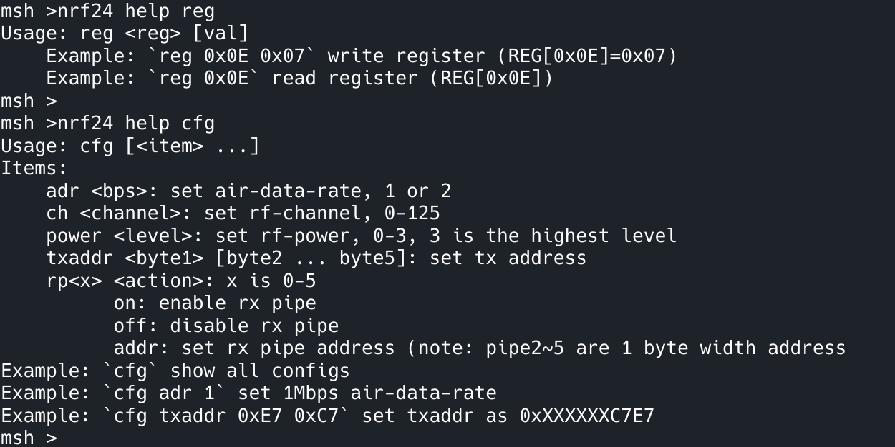
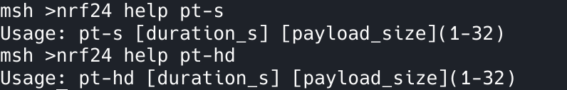

# 使用前必读

## I. 必要了解（关于 nRF24L01）

### 1. nRF24L01 特点

- nRF24L01 是一个无线通信模块，其通信方式类似**半双工**

- nRF24L01 通信以包为单位，一个包最多携带 32 字节的数据

- nRF24L01 中有增强性突发模式，该模式可实现自动应答、重传等机制而无需外部主控的干预. 在该模式下有两个角色：Primary Transmitter（PTX）和 Primary Receiver（PRX）.

- 要使 nRF24L01 模块间通信必须匹配关键设置：速率、地址、频率(频道)、CRC 等

### 2. PTX、PRX 通信过程简要说明 （增强性突发模式）

1. PTX 方发送数据
2. PRX 方接收到数据
3. PRX 方回应一个 ACK，该 ACK 可以携带数据（发送给 PTX 方的）
4. PTX 方接收到 ACK (可能包含 PRX 发送来的数据)

从上述通信过程可以看出：_PTX 属于主动方，PRX 属于被动方。如果 PTX 方不发送数据则也无法接收数据，同时 PRX 方即不能发送也无法接收到数据。_

### 3. 当前驱动特点

- 默认项（不可配置）
    - 5-byte 地址宽度

- 支持多实例
- 支持轮询或中断方式
- 高灵活性

## II. 使用流程


### 1 初始化


示例

```c
// ...
#include "nrf24l01.h"


void foo(void) {

    /* 0. 全局初始化. (目前非必要) */
    nrf24_global_init();

    /* 1. 创建 nrf24_t 变量 (n实例n变量).
    *
    *   (note: 留意变量的生命周期)
    */
    nrf24_t g_nrf24;

    /* 2. 对实例进行初始化.
     *
     * (note: 此时不会发生(/不涉及)和设备的通信)
     * 
     * 有两个API可选，一是会自动生成 SPI 设备，二是用户自行提供已挂载的 SPI 设备.  
     * 变量值实例（具体以所在平台为准）：
     *   VAR_SPI_DEV: “spi10”
     *   VAR_SPI_BUS: “spi1”
     *   VAR_CE_PIN: “PB11” 
     *   VAR_CS_PIN: “PB12”
     */
#ifdef AUTO_GEN_SPIDEV
    nrf24_init_ins_with_auto_spidev(&g_nrf24, VAR_SPI_DEV, rt_pin_get(VAR_CE_PIN), VAR_SPI_BUS, rt_pin_get(VAR_CS_PIN));
#else
    nrf24_init_ins(&g_nrf24, VAR_SPI_DEV, rt_pin_get(VAR_CE_PIN));
#endif

    /* 3. 正式初始化 (配置设备).
     *
     * 有两个API可选，一是简洁版(仅需角色配置），二是自定义版(更多配置项).  
     */

#ifdef CUSTOM_SETUP
    /* 自定义配置  */
    nrf24_user_cfg_t ucfg;
    nrf24_usercfg_init_default(&ucfg);

    // 更改配置项 ...
    ucfg.rxpipes[0].enable = 1; // enable pipe
    ucfg.rxpipes[0].enable_aa = 0; // disable auto ack

    /* Setup (PRX)
     * Note: 此处的 nrf24_default_regval_list 是寄存器级公共配置(如 crc, irq mask, ...)，一般无需改动. 
     */
    nrf24_setup_custom(&g_nrf24, NRF24_ROLE_PRX, &ucfg, nrf24_default_regval_list, nrf24_default_regval_list_num); 
    
#else 
    /* Setup (PRX) */
    nrf24_setup(&g_nrf24, NRF24_ROLE_PRX); 
#endif

    /* 4. 至此，设备就绪 */

}

```

### 2 运行

这里主要是收发数据和错误处理，逻辑如下，具体参考代码可以查看 `demo` 文件夹下的各个示例(有 中断/轮询 PTX/PRX, 监听, 广播)

发送逻辑：

1. 检测是否有可用/空闲的发送缓冲
2. 写入数据到发送缓冲
3. (可选)(轮询或中断) 等待发送完成

接收逻辑：

1. (轮询或中断) 检测是否有数据可接收 (即非空的接收缓冲)
2. 读取数据

错误处理逻辑：

1. (轮询或中断) 检测是否有错误发生 (主要是PTX角色的发送失败)
2. 处理错误 (重发等)

重要API:

- `uint8_t nrf24_read_and_clear_status(nrf24_t *nrf24);
`: 获取并清除状态
- `nrf24_status_enum_t nrf24_status_routine(nrf24_t *nrf24, uint8_t sta) 
`: 解析状态, 其返回值指示了 发送|接收|错误 的情况


### 3 逆初始化

todo

## III. 其它

todo

### CLI 命令






- `pt-s` 性能测试，单工 只发 (PTX) /只收 (PRX)
- `pt-hd` 性能测试，半双工 发送接收